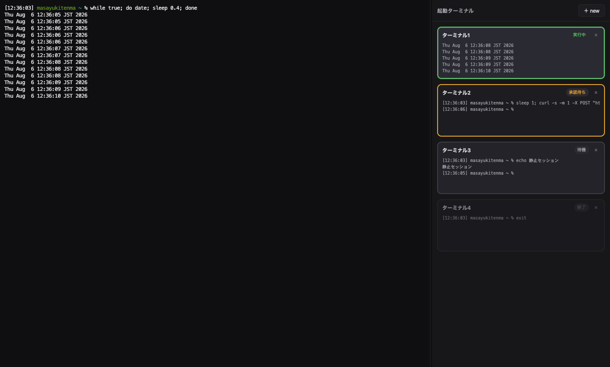

# Claude Term

Claude Code / Codex の複数セッションを管理するターミナルアプリ(macOS / Apple Silicon)。デスクトップがターミナルウィンドウだらけになる問題を、**1ウィンドウ = メイン表示 + セッションカード一覧** で解決します。



- 左: メインターミナル(フル表示)
- 右: 起動中セッションのカード一覧。AIセッションは種別・モデル・使用量をコンパクトに表示し、通常のターミナルは画面末尾5行をプレビュー
- カードの枠色と背景でセッション状態が一目で分かる。実行中は緑がかった背景全体に斜めの光がゆっくり流れ、待機中は静止する(OS の「視差効果を減らす」設定では光の動きを止める):

| 状態 | 枠色 | 意味 |
|---|---|---|
| 実行中 | 緑 | Claude Code / Codex が処理中(または出力が流れている) |
| 承認待ち | オレンジ(点滅) | ツール承認や入力待ちで止まっている。**見るべき** |
| 待機 | グレー | プロンプトに戻って静止している |
| 状態未取得 | グレー | Codex は起動しているが、状態通知がまだ届いていない |
| 終了 | 暗色 | シェルがシグナルで異常終了した(`exit` / Ctrl+D による終了は、直前コマンドが失敗していてもカードごと自動で閉じる)。Enter でカードを閉じる |

- 承認待ちになると **macOS 通知**が届き、**Dock アイコンに承認待ち件数のバッジ**が付きます。通知クリックでそのセッションに直接ジャンプ
- Claude Code / Codex の応答完了も通知します。カードには検知したエージェント名を表示します
- カードには**モデル名・コンテキスト残量**と、取得できた**累計コスト・トークン数・利用上限の残量**を表示します(コンテキスト残 20% 以下でオレンジ表示)
- カードタイトルはセッションの**現在のディレクトリ名**(`cd` に追随)
- カード名のすぐ下に **Claude Code / Codex** のラベルとモデル名、その下に使用量を表示します。応答後の待機中も同じ配置を保ち、AIを終了するとターミナルのプレビューに戻ります。Codex は状態通知が未取得でもラベルを表示し、プレビューを隠します。モデル・使用量は取得後に表示します。承認要求の詳細は「承認待ち」にマウスを重ねると確認できます。

カードをクリックするとそのセッションがメインにフル表示され、裏のセッションも動き続けます。「＋ new」はログインシェル(通常は zsh)を即座に開きます(**メイン表示中のセッションと同じディレクトリ**で開き、セッションが無ければホーム)。`cd` での移動や `claude` / `codex` の起動は通常のターミナルと同じように自分でコマンドを打ちます。

Codex も通常の `codex` 起動で状態連携できます(初回は下記の hooks 設定が必要)。Codex CLI 自体は別途インストールが必要です。

**改行入力の支援**: **Shift + Enter** はどのセッションでも改行として送れます(claude 実行中は `\`+Enter に、それ以外は LF = Ctrl+J 相当に変換 — **codex でも改行になります**)。claude 実行中(hooks 連携が必要)はさらに「**行末スペース + Enter**」でも改行できます。通常のシェルでは Shift+Enter は Enter と同じ動作になるだけで、副作用はありません。

## インストール

### A. ビルド済み DMG(Releases からダウンロード)

[Releases](../../releases) から `Claude Term-<version>-arm64.dmg` をダウンロードし、開いて `Claude Term.app` を Applications にドラッグしてください。

**重要**: 配布物は ad-hoc 署名(Apple の公証なし)のため、ダウンロード後そのまま開くと macOS に「開発元を確認できない/壊れている」と拒否されます。インストール後に一度だけ以下を実行してください:

```sh
xattr -cr "/Applications/Claude Term.app"
```

(またはシステム設定 → プライバシーとセキュリティ → 「このまま開く」)

### B. ソースからビルド(推奨・警告なし)

必要環境: macOS (Apple Silicon) + Node.js 20+

```sh
git clone https://github.com/mtenma/claude-term.git
cd claude-term
npm install
npm start            # そのまま起動(開発モード)
npm run package      # release/ に自分用の .app と DMG を生成
```

自分のマシンでビルドしたアプリは Gatekeeper の警告なしで起動できます。

## Claude Code の状態検知(hooks / statusLine 連携)

「承認待ち=オレンジ」の正確な検知とメトリクス表示のため、初回起動時に同意ダイアログを出した上で `~/.claude/settings.json` に **ガード付き hooks(8件)** と **statusLine 設定** を追記します。

- 追記されるコマンドはすべて次の形式です(`# claude-term-state-hook` マーカー付き):

  ```sh
  [ -n "$CLAUDE_TERM_PORT" ] && curl -s -m 1 -X POST "http://127.0.0.1:$CLAUDE_TERM_PORT/state/$CLAUDE_TERM_SESSION/<state>" >/dev/null 2>&1 || true # claude-term-state-hook
  ```

- `CLAUDE_TERM_PORT` は Claude Term のセッション内にだけ存在する環境変数です。**通常のターミナル(iTerm2 等)で claude を使うときは何も実行されません**(ガードで no-op)。
- 対象イベント: `SessionStart` → 待機(claude 起動を検知)、`UserPromptSubmit` / `PreToolUse` / `PostToolUse` → 実行中、`Notification`(permission_prompt|elicitation_dialog|agent_needs_input)→ 承認待ち(通知に要求内容を表示)、`Stop` → 待機、`SessionEnd` → 検知解除
- `Notification` の `idle_prompt` は「待機(グレー)」への復帰に使います。承認待ちや応答完了の通知にはしません
- [Claude Code の仕様](https://code.claude.com/docs/en/hooks#stop)で、中断時は `Stop` が届きません。hook と画面内容の変化が約60秒途絶えた場合も待機へ戻します。同じ画面の再描画やカーソル制御だけでは、この時間を延長しません。中断の反映には最大約60秒かかり、無出力で長く処理する場合も待機と推定されることがあります
- statusLine: `~/.claude/claude-term-statusline.sh` を設置し、`settings.json` の `statusLine` が**未設定の場合のみ**設定します(独自の statusLine を使っている場合は一切触れません)。スクリプトは Claude Term のセッション内でのみ動作し、セッション情報 JSON をアプリへ転送してモデル名・コンテキスト残量・コストをカードに表示、claude の画面にも同じ内容のステータス行を出します
- 書換え前の内容は `~/.claude/settings.json.backup-claude-term` に保存されます。
- 保存直前に設定を読み直し、確認ダイアログの表示中に行われた編集も保持します。不正な設定は上書きせず、書込みは一時ファイルからの置換で行います。

### 削除手順

`~/.claude/settings.json` から `claude-term-state-hook` を含む hook エントリと `statusLine` 設定(`claude-term-statusline` を含む場合)を削除し、`~/.claude/claude-term-statusline.sh` を消すだけです。同意をやり直したい場合はアプリの設定ファイル(`~/Library/Application Support/Claude Term/config.json`)の `hooksConsent` を消してください。

hooks を追記しない場合もアプリは動作します(出力の有無による実行中/待機の判定と、ターミナルベルによる要注目検知のみになります)。

## Codex の状態検知

1. アプリ起動時の Codex 状態検知設定ダイアログで有効化します。
2. 「＋ new」でターミナルを開き、通常通り `codex` または `codex resume` などを実行します。Codex の `/hooks` を開き、`claude-term-codex-hook` を含む定義を確認して信頼します。未信頼の hooks は Codex が実行しません。
3. 次の指示から、実行中・承認待ち・応答完了がカードと通知に反映されます。未取得の間は「状態未取得」と表示します。hook 定義を更新した場合は Codex 側で再確認が必要です。開発版・配布版の切替やアプリの移動だけでは、定義が変わらないようにしています。

`$CODEX_HOME/hooks.json`(通常は `~/.codex/hooks.json`)に8種類の同期 hooks を追加します。既存の hooks とメタデータは保持し、変更前のファイルを `hooks.json.backup-claude-term` に保存します。`config.toml`、認証情報、Codex の信頼設定は変更しません。`features.hooks = false` などで無効化している場合は、その設定が優先されます。

イベントと信頼手順の仕様は [Codex Hooks 公式ドキュメント](https://learn.chatgpt.com/docs/hooks)を参照してください。

| イベント | アプリの扱い |
|---|---|
| `SessionStart` | 起動・再開を検知して待機。処理途中の compact は除外 |
| `UserPromptSubmit` / `PreToolUse` / `PostToolUse` | 実行中。別の承認が残る間は承認待ちを維持 |
| `PermissionRequest` | 承認待ち。理由があれば表示し、なければコマンドやツール名を表示 |
| `Stop` | 待機へ戻し、応答完了を一度だけ通知 |
| `Interrupt` | 待機へ戻す。応答完了通知は出さない |
| `SessionEnd` | 状態とモデル表示を解除。CLI が起動したままなら Codex ラベルは維持 |

無出力の推論中も「実行中」を維持します。子エージェントの承認も表示しますが、子の処理終了で親の応答完了を通知しません。Codex CLI 0.153.4 の既定の端末タイトルでは、承認画面から実行中への復帰を検知し、コマンドの終了前に「承認待ち」を解除します。端末タイトルを無効化・変更してこの変化を検知できない場合は、対応する `PostToolUse` またはターンの終了・中断で解除されます。単なる質問・入力待ちは `PermissionRequest` の対象外です。

通知先はターミナルの `CLAUDE_TERM_PORT` / `CLAUDE_TERM_SESSION` 環境変数で渡します。アプリから開いた zsh / bash には `codex` の連携用関数を追加し、引数をそのまま渡しながら、同値の `shell_environment_policy.set` 設定を実行時だけ指定します。これにより Codex CLI 0.153.4 の暗黙のサーバー共有を避けます。この版で、手入力による通常起動から開始・指示受付・応答終了と使用量が届くことを確認しています。

連携用関数はその CLI にだけ `CLAUDE_TERM_CODEX=1` を付け、hooks と独立して起動・終了を通知します。通知は呼出ごとの ID で対応付け、古い終了通知で新しい Codex カードを消しません。起動だけでは処理中か待機中かを判定できないため、最初の hook が届くまでは「状態未取得」とします。ユーザーのシェル設定ファイルは変更しません。zsh は一時的な `.zshenv` から元の設定を読み、`ZDOTDIR` も復元します。bash は関数の環境変数継承を使います。既存の `codex` 関数や後から定義した関数は優先します。`command codex`・実行ファイルの絶対パス・別のシェルへの切替など、連携用関数を通らない起動や `--remote` は状態連携の対象外です。

Electron と通知スクリプトのパスは、起動元の PTY に `CLAUDE_TERM_EXECUTABLE` / `CLAUDE_TERM_CODEX_RELAY` として渡します。hooks の定義には実際のインストール先を埋め込みません。絶対パスを使っていた旧定義からの更新時は `/hooks` で一度確認し、アプリ内に新しく開いたターミナルから Codex を起動してください。

通知用スクリプトはアプリに同梱した Electron で実行し、エージェント名・モデル・イベントの識別子・承認理由・使用量の数値をローカルHTTPサーバーへ送ります。プロンプト・ツール出力・記録のパスは転送しません。通知は承認を許可・拒否せず、アプリに接続できなくても Codex の処理を継続します。CLI が異常終了した場合も、連携用関数が状態を解除します。

カードには、取得できた時点で**累計トークン数・コンテキスト残量の概算・利用上限の残量(5時間/週間など)**を表示します。hook の `transcript_path` が示す同一セッションの記録から `token_count` の数値だけ読み取り、hook の到着時に更新します。コンテキスト残量は累計ではなく直近のトークン量とウィンドウサイズから計算するため、圧縮後の残量も反映されます。金額は推定しません。記録の形式は Codex の安定した API ではないため、未知の形式・記録なしの場合は使用量を省略し、状態検知は続けます。

削除する場合は `hooks.json` から `claude-term-codex-hook` を含む command エントリを取り除きます。アプリ側の同意をやり直す場合は `~/Library/Application Support/Claude Term/config.json` の `codexHooksConsent` だけを削除してください。

## tmux / ssh でのコピー(OSC 52)

ssh 先や tmux 内でコピーした内容は、クリップボード転送シーケンス(OSC 52)経由でローカルの macOS クリップボードへ届きます。tmux を使う場合は接続先の `~/.tmux.conf` に以下を追加してください(tmux 3.2+):

```tmux
set -s set-clipboard on
# 外側端末(xterm-256color)を OSC 52 対応として扱わせる
set -as terminal-features ',xterm-256color:clipboard'
```

- copy-mode でのコピー(`Enter` / `y` 等)がそのまま Mac のクリップボードに入ります(リモートの `pbcopy` / `xclip` はリモート側にしか書けないため不要)
- tmux 内の Neovim 等がアプリ自身の OSC 52 でコピーする場合は `set -g allow-passthrough on` も追加してください(tmux 3.3+)
- `mouse on` でドラッグ選択が tmux に奪われる場合は、⌥(Option)を押しながらドラッグすると Claude Term 側のローカル選択になります
- セキュリティのため、クリップボード読み出し要求(OSC 52 の `?`)には応答しません。書き込みも表示中のセッションからのみ受け付けます

## 開発

```sh
npm run check   # 型検査
npm run smoke   # SessionManager のスモークテスト(GUI 不要・attach 切替の欠落/重複ゼロを機械検証)
node scripts/smoke-hooks.mjs           # Claude / Codex hooks の設定マージ
node scripts/smoke-hook-installers.mjs # 設定保存・同意・失敗時の保全(一時ディレクトリのみ)
node scripts/smoke-codex.mjs           # Codex relay・状態・通知・セッション分離
node scripts/smoke-resize.mjs          # 日本語の欠落・追記・サイズ変更と出力の順序・切替
node scripts/smoke-terminal-resize.mjs # 全角境界・カーソル・保存位置・代替画面
CLAUDE_TERM_SCREENSHOT=/tmp/s.png CLAUDE_TERM_DEMO=states npm run shot  # 自動スクリーンショット
CLAUDE_TERM_SCREENSHOT=/tmp/codex.png CLAUDE_TERM_DEMO=codex npm start # Codex表示・入力・切替・リサイズ
CLAUDE_TERM_SCREENSHOT=/tmp/wrap.png CLAUDE_TERM_DEMO=resize-wrap npm start # DOM/WebGL・日本語の出力中リサイズ・シェル入力
CLAUDE_TERM_SCREENSHOT=/tmp/edge.png CLAUDE_TERM_DEMO=right-edge npm start # 句読点・太字等の右端欠け・描画位置・ズーム・切替
```

### アーキテクチャ概要

- Electron + node-pty + xterm.js。メインプロセスが全セッションの PTY を保持し、各セッションに `@xterm/headless` のミラー端末を並走させる(VS Code のターミナル復元と同じ構成)
- カード切替時は `@xterm/addon-serialize` のスナップショットと、その時点の cols/rows を renderer に送り、同じ寸法で復元
- 出力・寸法変更・スナップショットをセッションごとのキューで順序付け、パース完了後に renderer へ転送。renderer も同じ順序で処理し、旧寸法向けの出力が新寸法で解釈されるのを防止
- 全 PTY をメイン表示の cols/rows に合わせ、Codex などの出力途中の行は全角文字と論理的なカーソル位置を保って折り返す。xterm 6 の内部 API への依存は `src/shared/terminalResize.ts` に限定し、更新時は回帰テストで確認
- macOS の前面プロセスが zsh / bash などのシェルなら、入力行の再描画をシェルに任せる。画面側にも同じ選択を寸法変更とともに通知

## 既知の制限

- プレビューはテキストのみ(色は反映されない)
- Codex の金額表示は未対応。モデル名と、取得できたトークン数・コンテキスト残量の概算・利用上限の残量を表示
- Codex 連携には上記イベントに対応した CLI と hooks の有効化・信頼が必要
- シェルの入力編集中は xterm 本来のリサイズ処理を使うため、幅によって前の入力行の一部が残ることがある。シェル本体が改行せずに出力するスクリプトも、この従来の扱いになる
